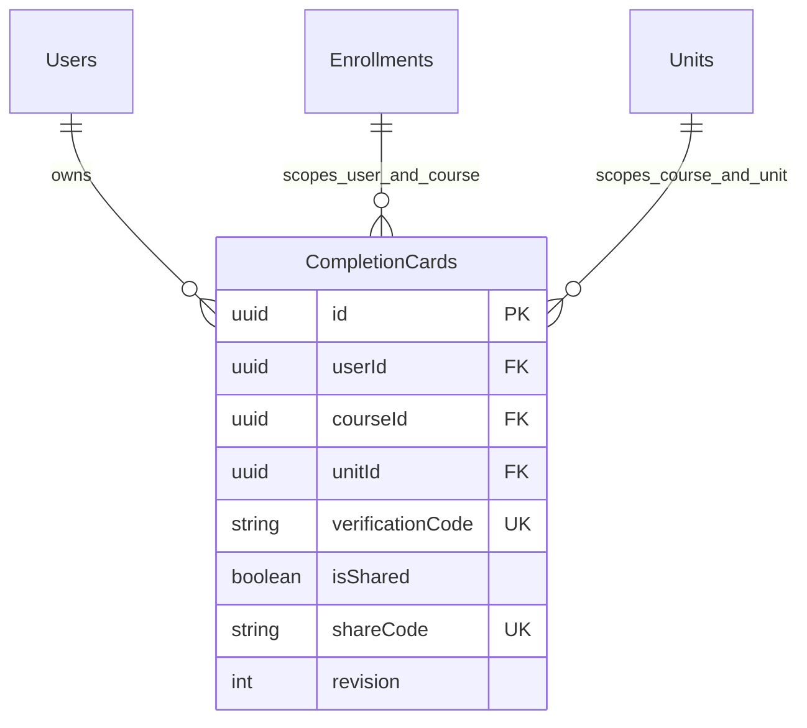

# Unit completion cards

Completing every currently published lesson in a unit issues one private card
inside the lesson-completion transaction. Published unit checks count as lessons.
The user/unit pair is unique, so repeated completion and concurrent claims reuse
the same card. Existing completed units can be claimed explicitly from their
journey link. Opening the cards page alone does not create or share anything.

A successful claim that issues a new card returns `201 Created` and a
`Location` for its private details. A claim for an existing card returns
`200 OK` with the same ID, even when two claims arrive concurrently.

The card stores the unit/course titles, first completion date, lesson counts,
average saved best graded score and issuance time. These result fields and its
random 128-bit verification code are immutable. Later content edits or repeats
do not rewrite the issued record. Ungraded-only work has no numeric accuracy.
It is a record of platform learning, not a language-level certification.

The learner name is read from the current profile rather than copied into the
card table. The sharing panel explains that the current display name is used.
Private artwork can be printed with the browser's native print controls.

## Privacy and sharing

Sharing starts off. Enabling it requires explicit confirmation that anyone with
the link can see the display name and unit result. The server enforces consent,
ownership, live account/session access and optimistic revision checks. An
uncertain write blocks further changes until the learner reloads saved state.

Public lookup uses a separate random 128-bit share code. Disabling sharing removes
it; enabling again generates a new code, so the old URL stays unavailable. The
stable verification reference alone is not a public lookup capability. Public
responses omit account IDs, email, course/unit IDs, sharing tokens and revisions.
Private, revoked, unknown and blocked/deleted-account links return the same 404.
Responses use no-store and public responses add noindex/nofollow/noarchive and
no-referrer headers. The public page also adds robots metadata. Turning sharing
off stops future lookups; it cannot erase copies already viewed or saved.

Owner export includes card records without the active sharing capability. Account
deletion removes all owned cards in its transaction and makes public links
unavailable. Audit reasons record sharing decisions without names or codes.

## Storage and API

AddCompletionCards adds the original CompletionCard fields plus snapshot/sharing
metadata, enrollment/unit/account foreign keys, uniqueness and score/code checks.
The existing deleted-account guard covers new card inserts. An additional trigger
protects issued results and requires sharing revision increments. Rollback refuses
to discard earned cards without an explicit data migration. schema.sql is updated.

- GET /api/v1/me/completion-cards: owner-scoped, paged, optional unit filter.
- GET /api/v1/me/completion-cards/{id}: owned record.
- POST /api/v1/me/units/{unitId}/completion-card: explicit historic claim.
- PUT /api/v1/me/completion-cards/{id}/sharing: confirmed revisioned choice.
- GET /api/v1/completion-cards/shared/{code}: public opt-in result only.

All operations are rate-limited. Private responses are private/no-store. Writes
lock learner then course where necessary, following existing content lock order.
The public lookup has no list or search endpoint.

## Verification — November 6

Nine PostgreSQL cases verify automatic issuance, incomplete-unit denial, concurrent
reuse, grade/no-grade results, snapshot preservation, explicit sharing consent,
revocation/rotation, stale-revision denial, current-name rendering, blocked and
foreign access denial, export/deletion, late deleted-account insert protection,
SQL immutability/uniqueness and rollback protection. The full backend suite passed
527 cases. Final full frontend suite passed 341 cases across 89 files, including
owner/public cards, uncertain sharing recovery, stale responses and the journey's
completion-only card link. Frontend and API production builds passed.

The additive migration applied locally and EF reported no pending model changes.
Authenticated native-browser/mobile/print/clipboard walkthrough and independent
sensitive-flow/public-release review remain pending. No real user card was shared
by the implementation tools; sharing tests used disposable synthetic accounts.

## Changed source

CompletionCard entity/configuration/migration; issuer, queries, contracts and
management; private/public controllers; completion, export and deletion services;
three PostgreSQL test files. Frontend adds the card API, reusable artwork, owner
and public pages/tests, routes and learning/journey/result links. Registers,
requirements, privacy/threat documentation and project memory track this slice.
