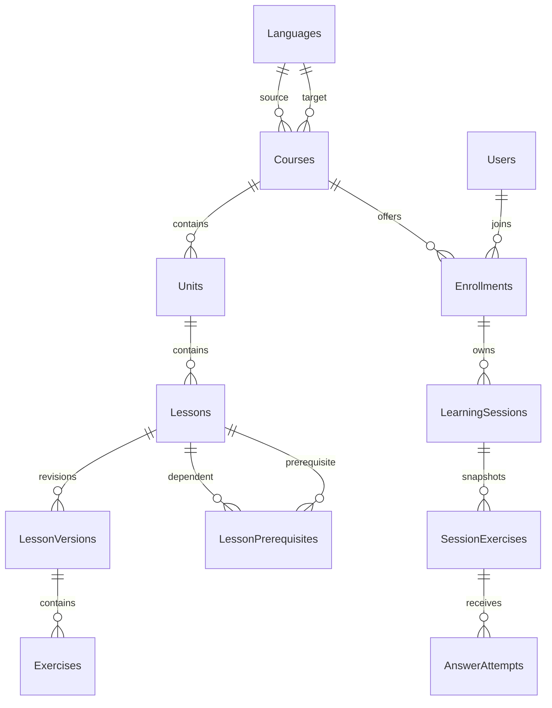
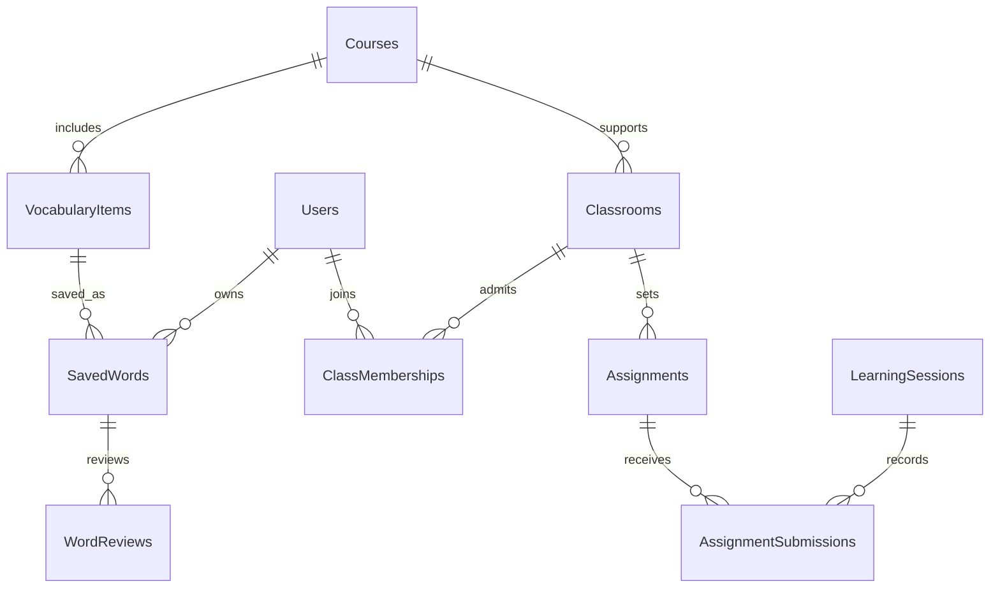
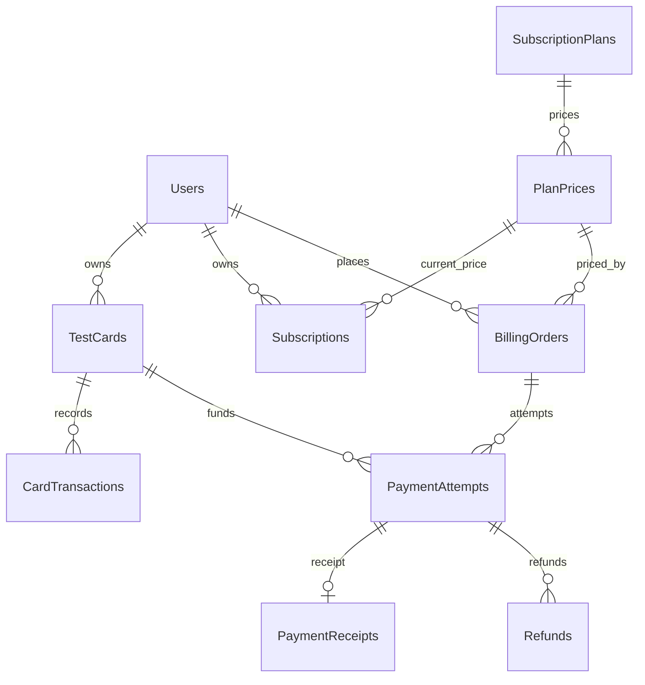

# მონაცემთა ბაზის ძირითადი კავშირები

დიაგრამები აჩვენებს კურსის გამოქვეყნების, სასწავლო პროგრესის, კლასებისა და
სიმულირებული გადახდების ძირითად კავშირებს. ცხრილების სრული აღწერა და ყველა
შეზღუდვა მოცემულია [SQL სქემაში](../database/schema.sql).

## კურსი, გაკვეთილი და სესია

გაკვეთილის აქტიური ვერსია იმავე გაკვეთილს ეკუთვნის. სესიის სავარჯიშო
ინახავს დაწყებისას გამოყენებულ შინაარსს, ამიტომ ახალი ვერსიის გამოქვეყნება
უკვე დაწყებული სესიის შეფასების წესებს არ ცვლის.

## ლექსიკა და კლასი

## სიმულირებული გადახდები

გადახდის მცდელობის შედგენილი უცხო გასაღებები აერთიანებს მომხმარებლის
იდენტიფიკატორს შეკვეთასთან და სატესტო ბარათთან. ამ ცხრილებში რეალური
საბანკო ბარათის ნომრები და CVV არ ინახება.
